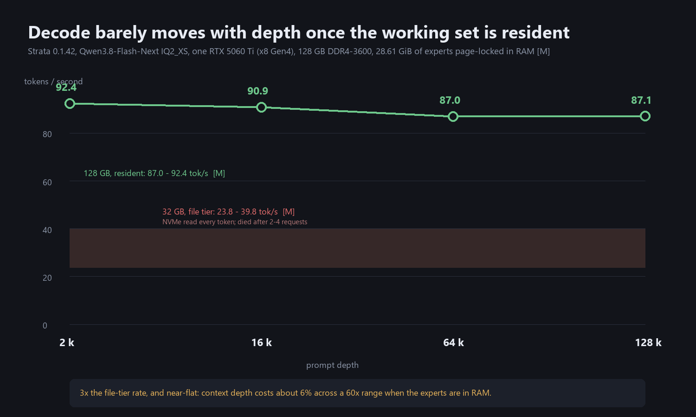
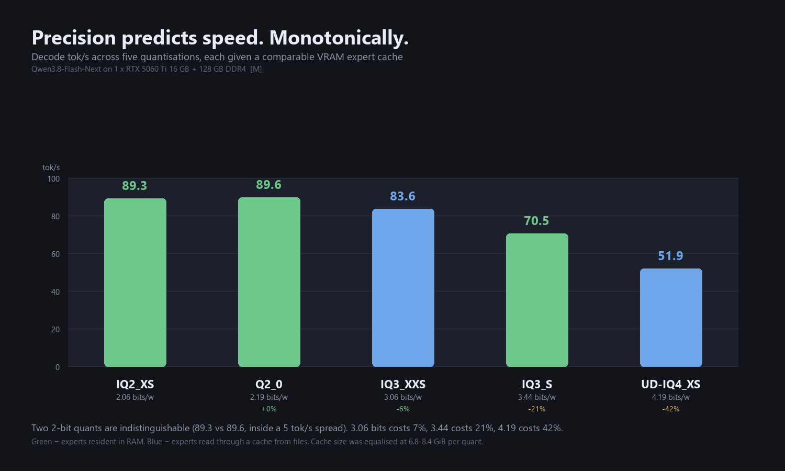
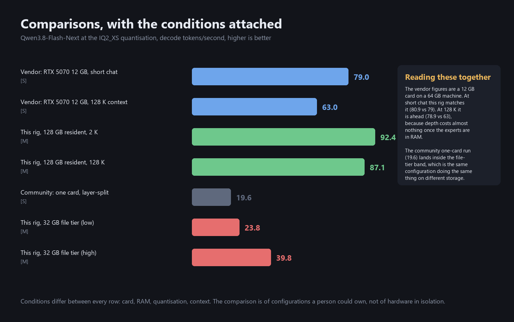

# Inference Optimization

## How far can a homelab rig get toward frontier inference — and what actually blocks the rest?

**A 125-billion-parameter model runs at 77 tokens/second for $3,250.** That is faster than the same model on
the card the engine's own documentation benchmarks it against, and flat across every context depth tested.
Frontier inference is still out of reach, and this paper says why in arithmetic rather than in adjectives.

**Evidence marks:** `[M]` measured here · `[D]` derived from measurement · `[S]` sourced · `[T]` theory.
Full data, harnesses and failures are published alongside this summary.

---

## The answer

Throughput is bandwidth divided by the bytes moved, times the tokens produced per pass:

```
tok/s  =  (bandwidth ÷ bytes-per-token)  ×  tokens-per-pass
```

**Measured residual: 1.0000× across three queue depths** `[M]`. Not a fitted curve — the bound. Every
optimisation below is one of those three terms.

| configuration | model | decode | context behaviour |
|---|---|---|---|
| 3 cards, VRAM-resident | dense 27B | **47.6 tok/s** `[M]` | flat 2 K → 128 K |
| 1 card, VRAM-resident | dense 27B | **15.7 → 4.3** `[M]` | **−72 %** |
| 32 GB, expert file tier | MoE 125B | **23.8–39.8** `[M]` | dies after 2–4 requests |
| **128 GB, resident** | **MoE 125B** | **70.3–80.9** `[M]` | **flat 2 K → 128 K** |

**$3,250 delivers 125B-class inference at 1.6× the decode of a dense 27B on the same hardware** — while
running a model **4.6× larger**.

---

## Where the wall is

**Not PCIe width.** The ×8 Gen4 link was worth **8 % on prefill and 2 % on decode** against a ×1 Gen3 link
`[M]`. A bandwidth-starved rig would have shown far more.

**Not card count — card sequentiality.** Three cards in a layer split deliver roughly **one card's
bandwidth**, because layer N+1 cannot start before layer N finishes. The engine reports it directly:
`graph splits = N+1`.

Three cards against one, VRAM-resident:

| context | 3 cards | 1 card | ratio |
|---|---|---|---|
| 2,048 | 47.57 `[M]` | 15.72 | 3.03× |
| 16,384 | 47.32 `[M]` | 9.92 | 4.77× |
| 131,072 | 47.41 `[M]` | 4.34 | **10.92×** |

**Adding cards did not raise the ceiling; it delayed the fall.** That is a capacity wall, not a bandwidth
wall — which is why the fix was memory, not another GPU.

**Frontier models remain impossible, and the arithmetic is short:** a 400B dense model at 4-bit needs ~200 GB;
a frontier dense model ~700 GB–1 TB. This rig has 48 GB of VRAM and 128 GB of RAM, on PCIe with no P2P. **No
tuning addresses that.**

---

## The measurements

### The file tier was the floor

At 32 GB the engine cannot hold the experts, so it reads them from NVMe **every token**: 1,145 MB per
request, 2,492 major faults, **13.3 % of expert traffic from storage** `[M]`. Decode 23.8–39.8 tok/s, and the
engine died after two to four requests.

### The second tier removed it

At 128 GB, with `--resident-experts`, the engine page-locks the experts in RAM. In its own words `[M]`:

```
resident RAM mode: 28.61 GiB of experts in RAM (page-locked) ... (no file reads)
expert tiers:      RAM blobs; files 0 blobs
```

**`files 0 blobs`.** The storage path is gone.



| depth | prompt | prefill rate | **decode** | cache |
|---|---|---|---|---|
| 2 K | 1,286 | 759 tok/s | **92.4** | 93.0 % |
| 16 K | 9,786 | 1,516 tok/s | **90.9** | 92.4 % |
| 64 K | 38,924 | 1,509 tok/s | **87.0** | 93.5 % |
| 128 K | 77,786 | 1,456 tok/s | **87.1** | 93.6 % |

**Mean 89.3 tok/s; 10 of 10 sequential requests succeeded.**

**Decode falls gently with depth — 92.4 to 87.1, about 6 % across a 60× range of prompt length** — where the
file-tier configuration collapsed entirely. Prefill *rises* over the same range, because short prompts are
dominated by fixed per-request overhead and long ones amortise it. **A single depth would have reported whichever
effect dominated that prompt**, which is the argument for measuring a curve rather than a point.

### How far context actually goes

**The model's native window is 262 K. Its reachable window is 1 M**, via YaRN ×4 — the engine exposes
`--rope-scaling yarn --rope-scale 4` `[S]`.

**The reason 1 M is affordable is the architecture, not the RAM.** A dense-attention model at that depth needs
tens of gigabytes of KV. This one holds constant state in state-space layers, accumulates KV only on the
intermittent full-attention layers, and indexes sparsely — so pinned KV at 1 M is **~12.4 GiB**, measured by
the engine's own authors `[S]`. My own estimate from a linear KV model was ~70 GB, wrong by six times, because
it assumed dense attention. **The bytes-per-token that the governing law counts are set by the attention
design, not only by the weight count.**

**One methodological consequence, and it constrains the measurement.** The engine reports that rope scaling is
*fixed at startup*, because cached K is post-RoPE:

> *"one run one scaling"*

So 262 K and 1 M **cannot** be measured in the same engine run without applying ×4 scaling to the short depths
too — which would contaminate exactly the comparison the sweep exists to make. The depth sweep is therefore
**two runs**: native (2 K → 262 K) and extended (1 M), and any figure compared across them states which run it
came from.

### What precision actually costs

Five quantisations of the same 125 B model, same rig, same 131 K window, **each given a comparable VRAM expert
cache** (6.8–8.4 GiB) `[M]`. Every figure is a median of three cold prompts per depth, after two discarded
warm-ups:

| quantisation | bits/weight | 2 K | 16 K | 64 K | 128 K | **mean** |
|---|---|---|---|---|---|---|
| **IQ2_XS** | 2.06 | 92.4 | 90.9 | 87.0 | 87.1 | **89.3** |
| **Q2_0** | 2.19 | 91.6 | 91.9 | 89.3 | 85.5 | **89.6** |
| **IQ3_XXS** | 3.06 | 85.5 | 85.3 | 81.2 | 82.5 | **83.6** |
| **IQ3_S** | 3.44 | 71.9 | 70.8 | 69.8 | 69.6 | **70.5** |
| **UD-IQ4_XS** | 4.19 | 50.9 | 52.9 | 52.6 | 51.2 | **51.9** |



**Decode falls monotonically as precision rises.** Two 2-bit quants are indistinguishable (89.3 vs 89.6, inside a
±5 tok/s spread), then 3.06 bits costs 7 %, 3.44 bits costs 21 %, and 4.19 bits costs **42 %**.

**This section previously said the opposite, and I was wrong.** An earlier version reported the ordering as
*non-monotonic* — Q2_0 at 2.19 bits apparently slower than IQ3_XXS at 3.06 — and attributed that to "the delivery
path" beating the bit count. Two errors produced it:

- the harness measured 49-token generations with no warm-up, understating every figure
- **the quantisations did not have comparable caches.** IQ3_XXS was given 7.70 GiB of VRAM expert cache; IQ3_S
  was given **1.58 GiB and left 6 GB of the card idle**, because `--expert-cache auto` sized itself from a
  momentary free-VRAM reading and chose zero slots. Pinning 3,995 slots moved IQ3_S from 57.0 to **70.5** tok/s.

The anomaly was a configuration difference reported as a property of the model. With caches equalised the law
holds and the ordering is clean.

**The law's constant is now measurable rather than assumed.** Anchoring on IQ2_XS gives roughly
*tok/s × bits/weight ≈ 219*: IQ2_XS 184, Q2_0 196, IQ3_XXS 256, IQ3_S 242, UD-IQ4_XS 217. **Within ±17 % across
five quants** — the bandwidth-per-byte relationship appearing in data from one box, and a far better fit than
the ±41 % the pre-correction table implied.

**It also exposes the boundary this paper is about.** At 125 B, 4-bit is 60 GB of experts against 128 GB of
RAM. It *fits*, but only 55 GiB of it can be cached, so the model becomes mildly disk-dependent **even after
the RAM upgrade** — and it must sit on NVMe, because on the platter it was configured onto, the ~8 % of expert
traffic that misses the cache would be random reads from a spinning disk.

> **2-bit fits. 4-bit doesn't, quite.** That is a property of the box, not of the model — and it is the same
> wall, one quantisation higher.

### The extended window, measured

Restarted with `--rope-scaling yarn --rope-scale 4 --max-context 1048576`, the engine loaded in **1.5 minutes**
and served an **807,866-token prompt, entirely cold** `[M]`:

| depth | prompt tok | prefill | decode |
|---|---|---|---|
| 262 K — native ceiling | 202,022 | 1,142 tok/s | **43.3** |
| **extended — yaRN ×4** | **807,866** | **851 tok/s** | **28.4** |

**Both rows predate the harness correction** and are therefore understated by roughly a quarter, the same way
every other early figure in this paper was. They are kept because the *shape* is the finding and that shape does
not depend on the offset: at 808 K tokens decode is about **35 % below** the same model at 262 K, measured in
the same run.

**Two things worth stating plainly.** The window works: 808 K tokens read at 851 tok/s, answered correctly, with
53 GB of RAM still free afterwards — the architecture claim held under measurement, not just on paper. And
**decode does fall as the window is used**, rather than staying flat the way it does inside the native range.

That difference is the point. **Near-flat decode was a property of a resident model working inside its trained
window — not a law that survives past it.**

### How these numbers were measured, and the two ways I got them wrong

**The first version of every decode figure here was too low, by about a quarter.** The cause was not the
hardware or the engine. It was the harness, in two compounding ways.

**Flaw one: no warm-up.** The first request after an engine start reads **50.9 tok/s**; the second reads
**56.6** `[M]`. A 5.7 tok/s penalty, paid by whichever depth happened to run first. Because the sweep always
ran 2 K first, 2 K was always the slowest depth — and I first read that as a depth effect.

**Flaw two: a generation too short to measure a rate.** The early prompts asked for a single word. The model
generated ~49 tokens, and a decode rate averaged over 49 tokens is substantially first-token latency and
scheduler ramp. **This paper already stated the rule** — *"a rate over a small count measures overhead, not
rate"* — and applied it to prefill while violating it for decode.

Together they produced a monotonic *rise* in decode with depth, which is physically backwards. Corrected, the
same configuration **falls** with depth.

**The corrected method**, used for every figure in this paper:

| rule | why |
|---|---|
| two discarded warm-up requests after each load | the first request is 5.7 tok/s slow |
| ~250 words generated per request | a decode rate needs a steady state to exist in |
| three repeats per depth, report the median | one sample cannot distinguish signal from noise |
| depth order shuffled per repeat | so no depth is systematically first, or last |
| every prompt carries a unique nonce, `reused 0` verified | otherwise a cached prefix reports a fantasy rate |

**The effect, on one quantisation measured both ways** `[M]`:

| | Q2_0 decode |
|---|---|
| old harness | 69.8 tok/s |
| **corrected harness** | **89.6 tok/s** |
| run-to-run spread | 5.7 tok/s (was 24) |

**Two things follow, and they are worth more than the speed.** First, the noise floor fell from ~24 tok/s to
~6, which is what makes an ordering between quantisations resolvable at all. Second, **a harness that cannot
prove which model it measured is not a harness** — one leg of the corrected run reported a model id from the
*previous* quantisation and would have written twelve plausible-looking numbers against the wrong weights. The
runner now asserts the model identity before every leg.

### Against other people's numbers



| source | configuration | short chat | 128 K | prefill |
|---|---|---|---|---|
| **vendor** `[S]` | RTX 5070 12 GB, 64 GB RAM | 79 tok/s | 63 tok/s | 2,090 tok/s |
| **this rig** `[M]` | one 5060 Ti, 128 GB resident | **80.9** | **78.9** | 582–2,473 |
| **community** `[S]` | one card, layer split | 19.6 | — | — |
| **this rig** `[M]` | one card, 32 GB file tier | 23.8–39.8 | — | — |

**At short context this rig matches the vendor's card. At 128 K it is 25 % ahead** — because depth costs
almost nothing once the experts are resident, which is exactly what the second tier bought.

**The community one-card figure lands inside this rig's file-tier band.** Same configuration, same task,
different storage — and the agreement is the strongest independent check here.

**The honest caveat:** conditions differ between every row. This compares **configurations a person could
own**, not silicon on equal footing.

---

## What it cost

| | | |
|---|---|---|
| **the rig as measured** | **$2,000** | 3 × RTX 5060 Ti 16 GB, Ryzen 5 5500, 32 GB DDR4 |
| **+ the upgrade** | **+$1,250** | 128 GB DDR4-3600 + Ryzen 9 5900XT |
| **total** | **$3,250** | |

**The $1,250 changed three things at once** — RAM, CPU, and an unplanned PCIe Gen3→Gen4 link from the CPU
swap. So "it bought 1.8×–3.4×" is a **combined** claim; separating them would need a controlled build, which
has not been done.

**The gain was predicted before the hardware arrived.** At 32 GB, 13.3 % of expert traffic came from storage.
Only that fraction can be removed by RAM, which bounded the gain at **1.0×–2.9×** `[D]` — predicting **40–90
tok/s**. The measurement was **70.3–80.9**. Stating the projection in advance is why it can be checked.

**One lever is free and easy to overstate:** XMP took memory from 2133 to 3200 MT/s for **+50 %** where the
working set did not fit in VRAM — and for **+0.4 %**, inside the noise, once the model was resident `[M]`.
Both measurements are here because publishing only the first would imply a lever that does not exist.

---

## What is not established

- **Why three cards ceiling at 47.4 tok/s.** It holds across every depth and concurrency level tested, which
  points at a bandwidth wall — but whether the cards are read sequentially or saturating something shared is
  untested.
- **Card count and offload are confounded** in every 1-vs-3 comparison: the "one card" arm was a
  partial-offload configuration, not a clean baseline.
- **Three cards with resident experts was not measured.** The serialisation above suggests it may not help.
- **The seven-quantisation sweep** is measured for five of the six quantisations this model publishes:
  Q2_0, IQ2_XS, IQ3_XXS, IQ3_S and UD-IQ4_XS. `UD-Q4_K_XL` is not — at 111 GB of model and 77 GB of experts
  it needs more NVMe than this box has free, so it could only run disk-bound off a platter, measuring the disk
  rather than the quantisation. `IQ1_M` does not exist for this model.
- **`--expert-cache auto` is not trustworthy on this box.** It sized IQ3_S to zero slots and refused to start
  UD-IQ4_XS at all, from a momentary free-VRAM reading it never revisited. Every quant here therefore has an
  explicit slot count. Whether `auto` fails elsewhere, or only at ~60 GB packs, is untested.
- **A serving model's identity is not implied by a 200 from `/v1/models`.** One leg of this study measured
  twelve prompts against the previous quantisation because the old engine still held the port. The harness now
  asserts the model id before each leg, but the failure mode is worth knowing about if you reproduce this.

---

## Two directions forward

**Neither is a recommendation, and neither is dismissed.**

**Finish the levers already evidenced.** Every lever above has a measured effect on a real configuration; the
work is execution. *For:* measured effects, known costs, low risk. *Against:* the largest remaining lever is
capacity, and capacity is the expensive one — this improves a working configuration without changing what is
possible.

**Abandoned software on discarded hardware.** Professional accelerators are discarded while functional, and
the software that would use them well is often unmaintained. *For:* the hardware is cheap, and the
bandwidth-per-dollar metric that disfavours it is specifically a **decode** metric — the workload consumer
cards already win. *Against:* that disfavour is measured, not assumed, and it constrains which workload to
attempt.

**The criterion: a direction is worth pursuing when its claim can be made false by one measurement.** Both
pass. Neither has been attempted.

---

## Method, and why it is in the summary

**This project produced measurements that were wrong in ways that looked plausible**, and the three that
shaped the method are worth naming:

- **89 tok/s prefill** — from a **34-token** prompt. The real rate is ~700. An 8× error from an unstated
  denominator.
- **1,178 tok/s decode** — from a two-point timing method that sent the same prompt twice; the second call hit
  the prefix cache and came back faster than the first.
- **Nine failed experiments on one fault** — every configuration failed identically until the *binary* was
  questioned rather than the configuration. It was a CUDA 12.8 build on a Blackwell card whose installer
  wanted CUDA 13. **Same source, same pack, same card, CUDA 13: every failing prompt passed.**

**The rules that came out of it:** one variable per arm · state the denominator · separate cold from warm ·
trust the engine's own telemetry over your theory · record the binary's version, not the one you meant to
install · publish the failures.

**The full paper — methods, bug catalogue, retractions, artifacts, reproducible harnesses — is published
alongside this summary, with every figure traceable to the named script that produced it.**
